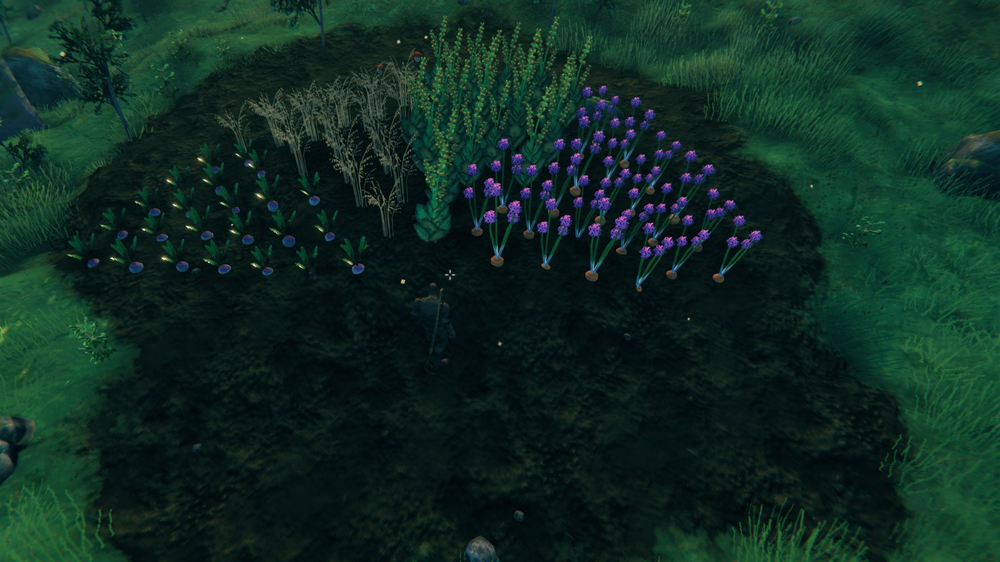
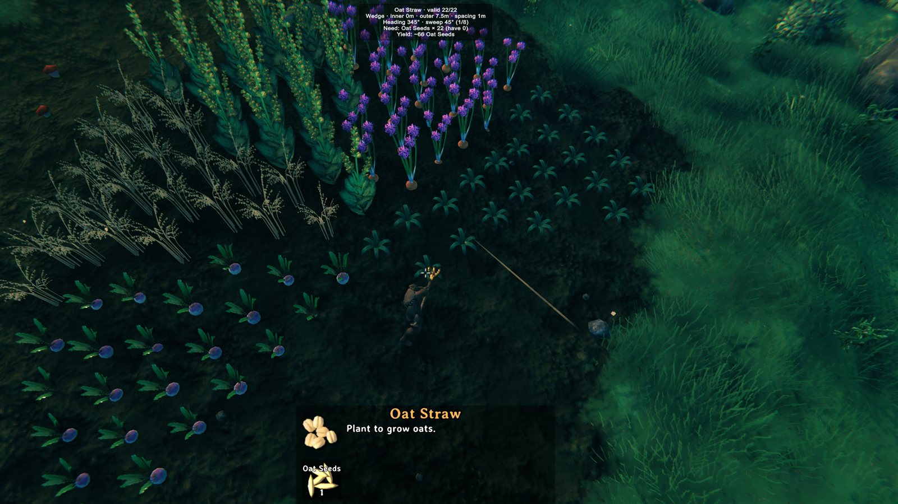

# OhMyGrid

Plant crops in **donuts, wedges and other non-square patterns** in Valheim. Lay
down a big onion ring, drop a smaller carrot donut concentric inside it, or build
a circle one wedge (circle slice) per crop. Stop fighting the rectangular grid.
Also: mass-pick / mass-refuel with `Shift+E`.





**Install:** [Thunderstore page](https://thunderstore.io/c/valheim/p/suspicious_geet/OhMyGrid/)
(direct download
[OhMyGrid-1.1.0.zip](https://thunderstore.io/package/download/suspicious_geet/OhMyGrid/1.1.0/)).
Use r2modman or Thunderstore Mod Manager to drop it into a Valheim profile.

## Features

- **Donut planting.** While holding the cultivator with a seed selected, a
  ring of ghost previews shows around your chosen center. Left-click plants
  the whole donut in one go.
- **Wedge planting.** A slice of the donut with a heading and a sweep. Turn it
  with the mouse wheel and widen it with `Shift+.` / `Shift+,`, in 15° steps
  (1/2, 1/3, 1/4, 1/6, 1/8, 1/12 of a circle). After each wedge the heading
  advances by one sweep, so consecutive wedges complete the circle. They tile
  exactly, with no doubled edges and no crowded tip.
- **Per-point validity.** Each ghost turns red when its spot is invalid —
  blocked by rocks/plants, out of reach, or on uncultivated soil. Green ones
  are the only ones that get planted, charged, and counted.
- **Cost + yield overlay** centered at the top of the screen: shows the
  current plant, valid/total point count, total seed cost, and expected yield
  — all live as you tune the radii. It also says how many points are out of
  reach (`[Grid] IgnoreReach` plants those too).
- **Four center modes**, cycled with `F7` (top-left HUD toast on change):
  - **Player** — donut follows you.
  - **Fixed** — pins the donut at your current spot. Walk away, donut stays.
  - **Cursor** — donut follows where the cultivator ghost aims.
  - **CursorSnap** — like Cursor, but the center snaps to the nearest
    remembered planting center (every donut/wedge you plant is saved), or to
    the centroid of nearby plants if there is none. Perfect for concentric
    donuts and for completing a circle wedge by wedge.
- **Geometry toggle.** `F6` cycles `Off → Donut → Wedge → Off`. In `Off`, the mod
  stays out of the way and you place one plant per click like vanilla.
- **Shift+E mass-interact** (hover-scoped, same-type only):
  - Hover a **Pickable** → harvest every Pickable of the same item type in
    range. Carrots don't sweep nearby strawberries.
  - Hover a **Fireplace** → fuel every Fireplace in range.
  - Hover a **Smelter / Charcoal Kiln** → feed every smelter in range.
- **Persists across sessions.** Center mode, geometry mode, radii, hotkeys,
  and toggles are all stored under `cgaggino.OhMyGrid.cfg`.

## Default hotkeys

All hotkeys are configurable under `[Hotkeys]` in the config file.

| Key | Action |
|---|---|
| `F6` | Cycle geometry: `Off → Donut → Wedge → Off` |
| `F7` | Cycle center mode: `Player → Fixed → Cursor → CursorSnap → Player` |
| `F8` | Dump every donut grid point to the BepInEx log |
| `]` | Outer radius +1 spacing step |
| `[` | Outer radius −1 spacing step |
| `Shift+]` | Inner radius +1 spacing step |
| `Shift+[` | Inner radius −1 spacing step |
| `.` / `,` or mouse wheel | Rotate wedge clockwise / counter-clockwise (one `AngleStep`) |
| `Shift+.` / `Shift+,` | Widen / narrow wedge (one `AngleStep`) |
| `Left-click` | Plant the entire donut / wedge (when holding a Plant ghost) |
| `Shift+E` | Mass-interact with the hovered object's type in range |

Defaults: `InnerRadius=2m`, `OuterRadius=6m`, `Spacing=1m`, `AutoSnapRadius=12m`,
`MassInteract.Radius=5m`. All editable in the cfg file (or via BepInEx
ConfigurationManager if you have it installed).

## Concentric donut workflow

1. Stand inside an existing donut of one crop (or anywhere if it's the first).
2. Tap `F7` until the HUD shows `Mode: CursorSnap`.
3. Aim near the center — the donut snaps to the centroid of the existing
   plants automatically.
4. Bring `[` until the outer radius matches the inside of the previous donut.
5. Swap seed type and left-click. The new ring lands concentric to the old one.

## Wedge-by-wedge circle workflow

1. `F6` until the HUD shows `Geometry: Wedge`. Set the radii with `[` / `]`.
2. Pick the slice size with `Shift+.` / `Shift+,` (for example 90° = 1/4).
3. Plant the first wedge. Then `F7` to `CursorSnap` and aim near the circle.
   The center snaps to the one you just planted (`AutoSnap: anchor`).
4. Swap seed type and left-click. The heading has already advanced by one
   sweep, so the new wedge starts exactly where the last one ended.
5. Repeat until the circle is closed.

## Building from source

You need a local Valheim install with BepInEx (the build references
`assembly_valheim.dll` and friends; they're not redistributable):

```powershell
$env:VALHEIM_INSTALL = "C:\Program Files (x86)\Steam\steamapps\common\Valheim"
dotnet restore
dotnet build -c Release
```

The output is `bin/Release/OhMyGrid.dll`. Drop it in your r2modman /
Thunderstore Mod Manager profile under `BepInEx/plugins/`.

## Known limitations

- **Centroid fallback is biased on asymmetric clusters.** Plantings made
  before 1.1.0 have no remembered center, so `CursorSnap` falls back to the
  plant centroid. For a half donut or an irregular patch, that is not the
  geometric center. Anything planted with 1.1.0+ snaps exactly.
- **Fixed-mode center doesn't persist across sessions.** The center *mode*
  saves and reloads as `Player` on the next launch (no anchor to restore).
  Other modes restore exactly as you left them.

## Planned (v1.2+)

- More geometries on the `F6` cycle: square grid, hex grid, spiral, and a
  user-drawn polygon.
- `Shift+E` support for more interactables (Beehive, Cauldron, Workbench
  repair).
- A toggle to **mass-fill** a single Smelter / Fireplace with one press,
  not just one tick per press.
- Optional ground ring rendered at the AutoSnap centroid so the snap target
  is visually obvious before you click.

## Compatibility

- Targets Valheim **1.0** (1.0.1+; 1.0.0 was built for 0.221.x and does not work on 1.0).
- BepInEx 5.x via `denikson-BepInExPack_Valheim` (5.4.2350+).
- **Tested on Valheim 1.0.15 (network version 40)** with BepInExPack 5.4.2350, Windows,
  1.0.2 build — play session with `BepInEx/LogOutput.log` review: 0 exceptions, seed
  accounting exact (`planted=18 … paidHere=17 paidByVanilla=1`, 18 seeds in → 0 left),
  ghosts render green/red with the cost overlay, Shift+E feeds only the aimed
  kiln/smelter slot, F7 cycles all four center modes.
- **1.1.0 tested on Valheim 1.0.21 (network version 41)** with BepInExPack 5.4.2360,
  Windows: a half circle built from four wedges of different crops, anchor snap,
  auto-advance, mouse-wheel rotation, 0 OhMyGrid exceptions.

### Known issues

- Valheim's own requirement panel (bottom of the build UI) still shows the cost of
  **one** plant while the donut is active; the mod's overlay at the top shows the real
  batch cost (`Need: … × N (have M)`) and that is what gets charged. Cosmetic; planned
  for 1.0.3.
- Client-only — no `ServerSync`. Use freely on dedicated/multiplayer servers
  without forcing other players to install.

## Contributing / releasing

PRs welcome. The dev release workflow (version bump, zip build, Thunderstore
upload via `tcli`) is documented in [`RELEASING.md`](RELEASING.md).

## License

MIT — see [LICENSE](LICENSE).
